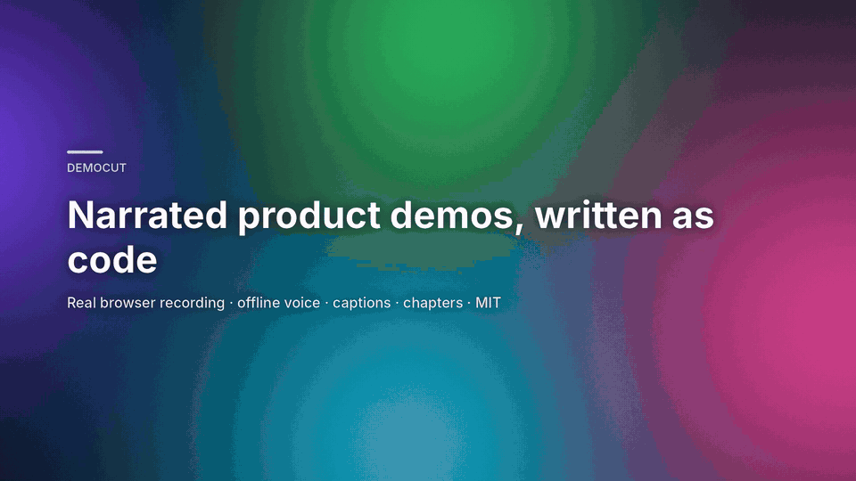
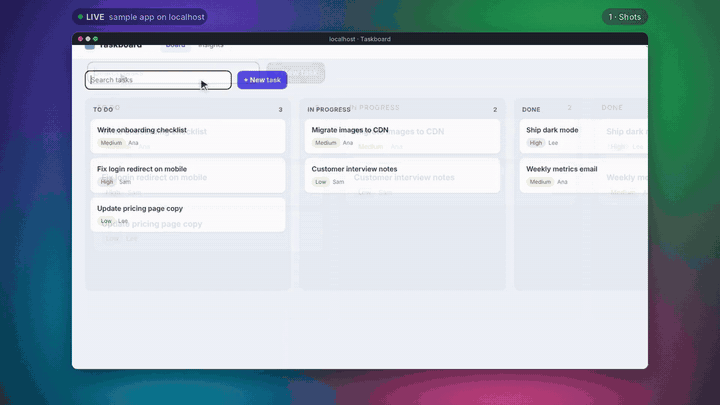
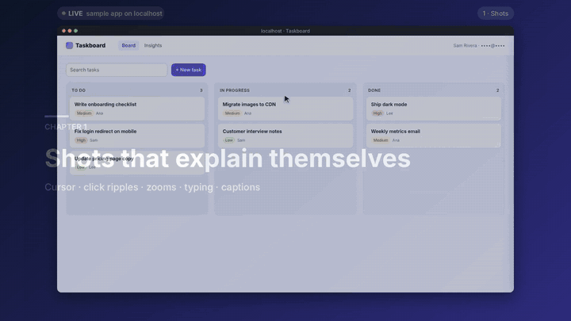
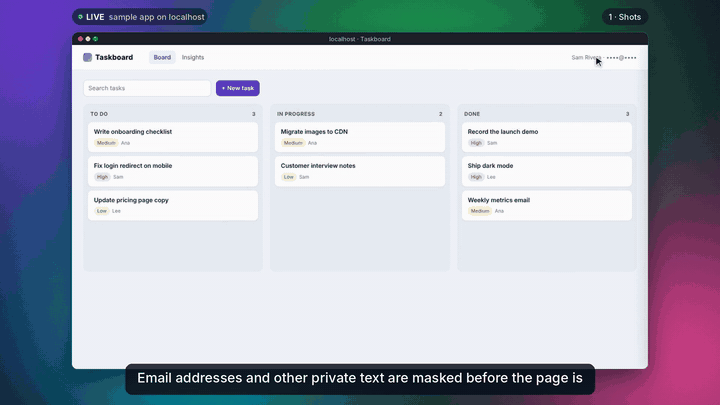
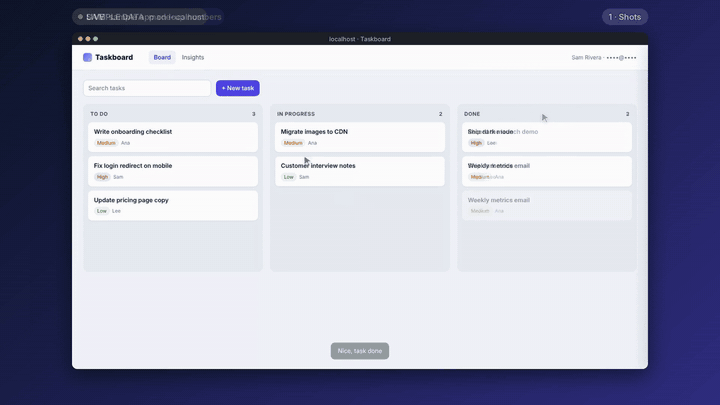
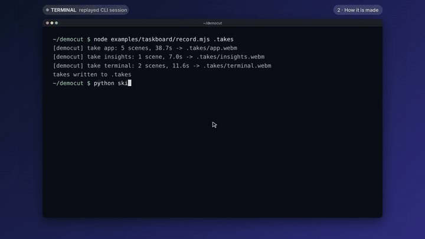
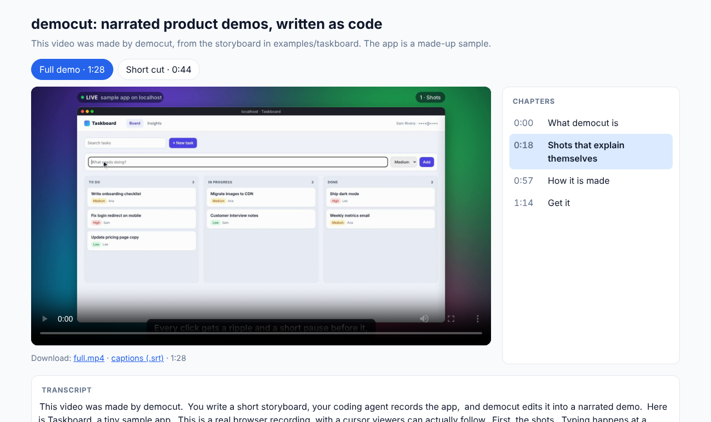
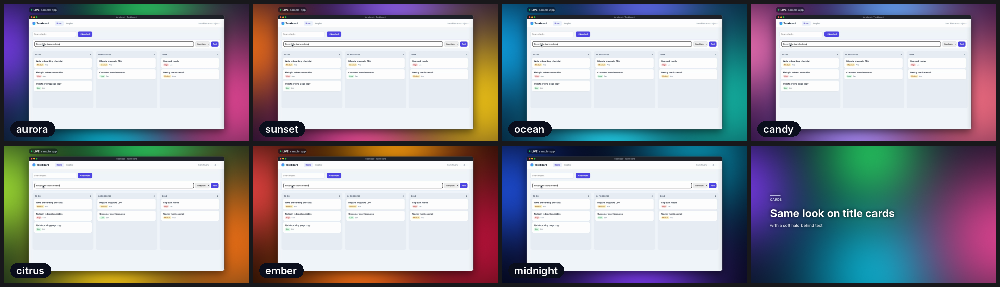

<div align="center">

# democut

### Your coding agent records your web app. democut turns it into a narrated demo video.

[](LICENSE)
[](https://github.com/javadfarshchi/democut/actions/workflows/ci.yml)
[](#quickstart)
[](skills/democut/SKILL.md)
[](#what-leaves-your-computer)

[**Watch the demo**](https://javadfarshchi.github.io/democut/) · [Quickstart](#quickstart) · [Prompts](#prompts-to-try) · [Features](#features) · [Docs](#docs)

<a href="https://javadfarshchi.github.io/democut/"></a>

<sub>This GIF was made by democut from <a href="examples/taskboard">examples/taskboard</a>. <a href="https://javadfarshchi.github.io/democut/">Watch the full video with voice, chapters and transcript.</a></sub>

</div>

## Quickstart

**1. Install** in Claude Code:

```
/plugin marketplace add javadfarshchi/democut
/plugin install democut@democut
```

Using Codex, Cursor, Gemini CLI or Copilot instead? Run `npx skills add javadfarshchi/democut`.

**2. Ask:**

> Make a 2-minute demo video of our signup flow on localhost:3000, plus a 30-second cut for the README.

Your agent writes the script, records the app, drafts a silent cut, checks its own frames, then builds the
final video. You get an MP4, captions, a GIF and a page to share.

<details>
<summary>Prerequisites (the agent will check these for you)</summary>

Node 18+, Python 3.9+ and ffmpeg. Then:

```bash
npm i -D playwright && npx playwright install chromium
pip install numpy opencv-python-headless pillow kokoro-onnx soundfile
bash skills/democut/kit/get-voice.sh        # offline voice, about 120 MB, once
python skills/democut/kit/init.py doctor    # shows anything still missing
```
</details>

## Prompts to try

- *"Record a 60-second tour of the dashboard at localhost:5173 for our launch tweet."*
- *"Make a feature video for the new export button. Use test data and label it as such."*
- *"Our UI changed. Re-record the onboarding demo and rebuild both cuts."*
- *"Demo the admin panel. Sign in with the test account from .env, but never show it on screen."*

## What you get

From one storyboard you get every cut you ask for:

| File | What it is |
|---|---|
| `full.mp4`, `short.mp4` | 1080p video with voiceover, burned-in captions and chapters |
| `short.gif` | A small GIF for your README |
| `full.srt`, `full.vtt` | Caption files for YouTube, LinkedIn or your own player |
| `index.html` | A page to share: switch between cuts, jump to chapters, read the transcript |
| `contact-sheet.png` | One frame per shot, so you can review the edit at a glance |

## Features

<table>
<tr>
<td width="50%"><br><b>A cursor people can follow.</b> Smooth movement, a short pause before each click, a ripple when it lands, and typing at a human pace.</td>
<td width="50%"><br><b>The camera zooms on what matters.</b> Smooth zooms onto the element you name, measured from the page, so they always land in the right place.</td>
</tr>
<tr>
<td><br><b>Private by default.</b> Email addresses, and any pattern you add, are replaced before the page is drawn, so they never reach the recording.</td>
<td><br><b>Honest about its sources.</b> Every shot carries a badge such as LIVE, STAGING or SAMPLE DATA, and captions explain why each step matters.</td>
</tr>
<tr>
<td><br><b>Terminal shots too.</b> Replay a command-line session inside the video, styled to match the rest.</td>
<td><br><b>A page to share.</b> Chapters, captions and a clickable transcript, in one file with no outside requests.</td>
</tr>
</table>

### Vibrant backgrounds, built in



Seven presets with slowly drifting colour, or your own colours or a brand image. One line in the storyboard:
`"theme": { "background": "sunset" }`. See [the storyboard format](skills/democut/references/storyboard.md).

Also in the box:
- **Tight pacing.** Page loads are cut, slow parts are sped up, and each shot lasts as long as its narration.
- **Chapter cards** that become MP4 chapters and links on the player page.
- **Re-runnable.** When the UI changes, re-record and rebuild. Narration audio is cached, so rebuilds are quick.

## What leaves your computer

Nothing. Recording, voice and editing all run locally.

| Step | Runs on | Online? |
|---|---|---|
| Recording | Playwright and Chromium | Only to reach your own app |
| Voice | [Kokoro-82M](https://github.com/hexgrad/kokoro), on your CPU | No (the voice files download once) |
| Editing and encoding | Python, OpenCV and ffmpeg | No |

## Without an agent

Everything the skill does, you can run yourself:

```bash
python skills/democut/kit/init.py new demos/signup --url http://localhost:3000
# fill in the TODOs in demos/signup/record.mjs and storyboard.json, then:
node demos/signup/record.mjs
python skills/democut/kit/build.py demos/signup/storyboard.json --takes demos/signup/.takes --out demos/signup/out --gif short
```

A recording script reads like a set of directions:

```js
const d = await Director.open(browser, 'app', '.takes');
await d.goto('http://localhost:3000');
await d.scene('add-task', async () => {
  await d.click('#add');
  await d.type('#title', 'Record the launch demo');
  await d.click('#save');
  await d.zoom('.card >> nth=0');
  await d.hold(1200);
});
await d.close();
```

Each scene becomes a shot. The storyboard lists the shots in order, with the narration for each and the shots that
go into each cut.

### Try the example

```bash
git clone https://github.com/javadfarshchi/democut && cd democut
npm i && npx playwright install chromium && pip install -r requirements.txt && bash skills/democut/kit/get-voice.sh
npm run example:record && npm run example:build      # writes out/ with the video you see above
```

## Docs

- [SKILL.md](skills/democut/SKILL.md): the workflow the agent follows
- [Director API](skills/democut/references/director.md): `click`, `type`, `zoom`, `scene`, masking, stubbed data, terminal shots
- [Storyboard format](skills/democut/references/storyboard.md): shots, cuts, chapters, badges, theme
- [Writing a demo people finish](skills/democut/references/storytelling.md)
- [Voices and licences](skills/democut/references/voices.md): Kokoro voices, or plug in any other engine

## Roadmap

- Vertical 9:16 cut for social video
- Background music that ducks under the voice
- Word-level caption timing
- More example apps

Ideas and PRs are welcome. See [CONTRIBUTING.md](CONTRIBUTING.md).

## Licence

[MIT](LICENSE) © Javad Farshchi. The default voice, Kokoro-82M, is Apache-2.0. See
[THIRD_PARTY_NOTICES.md](THIRD_PARTY_NOTICES.md).
